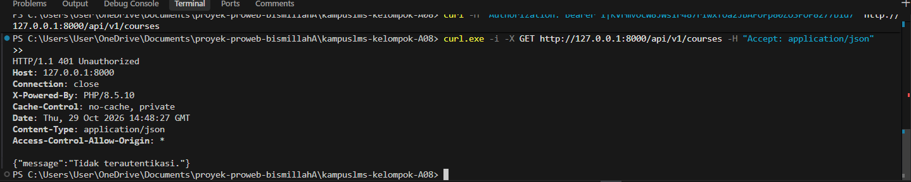
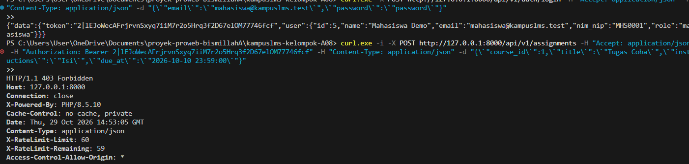
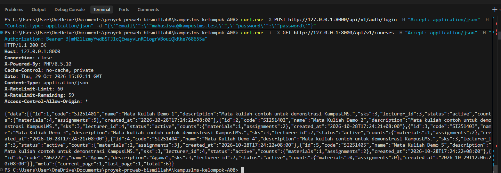
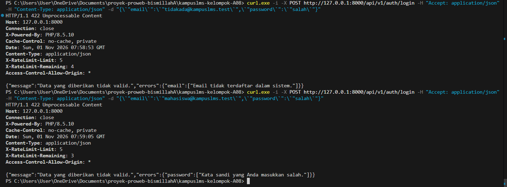

### Read 

1. Jalankan `php artisan install:api`. Baca perubahan yang terjadi di `bootstrap/app.php`.

    Jawaban : 
    
    Perintah `php artisan install:api` secara otomatis menambahkan pendaftaran file `routes/api.php` di dalam rantai metode `withRouting()` pada file `bootstrap/app.php`. Mengaktifkan file `routes/api.php`, Secara otomatis memberikan `prefix /api` untuk seluruh rute yang didaftarkan di dalam file tersebut, Menerapkan middleware group `api` (termasuk rate limiting/throttle dan sifat stateless). 


2. Buat satu endpoint `GET /api/v1/courses` sederhana.

    Jawaban : 
    Untuk membuat endpoint API ini, terdapat 2 file yang perlu ditambahkan :
    - Daftarkan Rute di `routes/api.php`    
    Tambahkan kode berikut ke dalam file `routes/api.php` (file ini otomatis dibuat setelah menjalankan php artisan install:api)

    ```
    <?php
    use Illuminate\Support\Facades\Route;
    use App\Http\Controllers\Api\AuthController;
    use App\Http\Controllers\Api\CourseController;
    use App\Http\Controllers\Api\AssignmentController;
    use App\Http\Controllers\Api\SubmissionController;

    /*
    |--------------------------------------------------------------------------
    | API Routes — KampusLMS (Laravel 12 / Sanctum)
    | Prefix Global: /api/v1
    |--------------------------------------------------------------------------
    */

    Route::prefix('v1')->group(function () {

        // --- 1. AUTENTIKASI PUBLIK (Rate limit: 5 permintaan per menit) ---
        Route::post('/auth/login', [AuthController::class, 'login'])
            ->middleware('throttle:5,1');

        // --- 2. RUTE TERPROTEKSI SANCTUM (Rate limit: 60 permintaan per menit) ---
        Route::middleware(['auth:sanctum', 'throttle:60,1'])->group(function () {

            // Autentikasi Pengguna
            Route::post('/auth/logout', [AuthController::class, 'logout']);
            Route::get('/me', [AuthController::class, 'me']);

            // --- RUTE ORANG 3: Courses, Assignments & Submissions ---
            Route::get('/courses', [CourseController::class, 'index']);
            Route::get('/courses/{id}', [CourseController::class, 'show']);

            Route::post('/assignments', [AssignmentController::class, 'store']);
            Route::match(['put', 'patch'], '/assignments/{id}', [AssignmentController::class, 'update']);
            Route::delete('/assignments/{id}', [AssignmentController::class, 'destroy']);

            Route::post('/submissions', [SubmissionController::class, 'store']);
            Route::put('/submissions/{id}/grade', [SubmissionController::class, 'grade']);
        });

    });
    ```

    - Buat Controller API di `app/Http/Controllers/Api/V1/CourseApiController.php`
    Buat controller baru yang bertugas mengambil data dari database dan mengembalikannya dalam format JSON

    ```
    <?php

    namespace App\Http\Controllers\Api;

    use App\Http\Controllers\Controller;
    use App\Models\Course;

    class CourseController extends Controller
    {
        public function index()
        {
            return response()->json([
                'status' => 'success',
                'data'   => Course::all()
            ], 200);
        }
    }
    ```


    Endpoint `GET /api/v1/courses` adalah jalur akses data untuk aplikasi lain, seperti Frontend React/Vue atau Mobile App. Tidak seperti rute web yang mengirimkan tampilan HTML (`view()`), endpoint API ini khusus mengirimkan data mentah berformat JSON melalui `response()->json()`.

3. Perbandingan CourseController versi Web vs API**


    Jawaban : 

    Persamaan utama dari `CourseController` versi web dan `CourseApiController` versi API terletak pada logika query datanya. Keduanya sama-sama memanggil model Eloquent yang sama untuk mengambil data dari database, contohnya dengan perintah `Course::all()`. Perbedaannya terletak pada tiga hal utama. Pertama pada format response: controller web mengembalikan tampilan HTML via `return view(...)`, sedangkan controller API mengembalikan data mentah terstruktur berformat JSON via `return response()->json(...)`. Kedua pada sistem autentikasi: controller web bergantung pada Session dan Cookie browser, sedangkan controller API bersifat stateless menggunakan Token (seperti Laravel Sanctum). Ketiga pada penanganan error: jika terjadi kesalahan, controller web biasanya melakukan redirect kembali ke halaman sebelumnya, sedangkan controller API langsung mengembalikan HTTP Status Code (seperti 422 atau 401) beserta pesan error berformat JSON.

4. Panggil endpoint API tanpa header Accept: application/json. Lalu dengan header itu. Catat bedanya.

    Jawaban : 
    
    Header `Accept: application/json` berfungsi sebagai penentu cara Laravel merespons sebuah permintaan (*request*). Tanpa header tersebut, Laravel menganggap akses berasal dari browser biasa, sehingga saat terjadi kesalahan autentikasi (401) atau gagal validasi, sistem akan melakukan *redirect* balik ke halaman sebelumnya atau menampilkan error berbentuk HTML. Sebaliknya, jika header `Accept: application/json` ditambahkan, Laravel secara otomatis mengenali *request* tersebut sebagai akses API, sehingga setiap error—mulai dari kegagalan autentikasi hingga masalah validasi—langsung dikembalikan dalam bentuk data JSON yang konsisten beserta kode status HTTP yang sesuai (seperti 401 Unauthorized atau 422 Unprocessable Content) tanpa proses *redirect*.

5. Jalankan `php artisan route:list --path=api`. Cocokkan dengan kontrak di spesifikasi.

    Jawaban : 

    

    Berdasarkan hasil perintah `php artisan route:list --path=api` pada terminal, terdapat 10 rute API yang aktif dengan prefix `/api/v1`. Rute tersebut terbagi atas autentikasi publik (`POST api/v1/auth/login`), autentikasi terproteksi (`POST api/v1/auth/logout` dan GET `api/v1/me`), manajemen mata kuliah (`GET api/v1/courses` dan `GET api/v1/courses/{id}`), pengelolaan tugas (`POST, PUT|PATCH` dan `DELETE` pada `api/v1/assignments`), serta pengumpulan dan penilaian tugas (`POST api/v1/submissions` dan `PUT api/v1/submissions/{id}/grade`). Seluruh endpoint tersebut telah terhubung dengan controller masing-masing di dalam namespace `Api\`.

### Break 

1. Kembalikan response()->json(User::all()) di satu endpoint uji

    Jawaban : 

    


    Uji coba ini menunjukkan bahaya dari mengembalikan model Eloquent mentah (`User::all()`) secara langsung ke dalam respon JSON. Ketika properti `$hidden` pada model `User` dinonaktifkan, Laravel tidak lagi menyaring data sensitif sehingga atribut rahasia seperti hash password dan `remember_token` ikut bocor dan tampil secara terbuka di layar. Kebocoran hash password ini sangat berbahaya karena penyerang dapat membongkar password asli pengguna. Oleh karena itu, dalam pengembangan API, sangat penting untuk selalu memastikan properti `$hidden` terkonfigurasi dengan benar serta menggunakan API Resources (`JsonResource`) agar hanya data tertentu yang diizinkan saja yang dikirimkan ke publik.

2. Hapus `auth:sanctum` dari grup route, panggil tanpa token

    Jawaban : 

    

    Menghapus middleware `auth:sanctum` dari grup route API menyebabkan seluruh endpoint privat kehilangan lapisan keamanan autentikasi. Akibatnya, pihak luar atau pengguna yang belum login dapat mengakses data sensitif aplikasi secara bebas tanpa perlu mengirimkan token autentikasi (unauthenticated access). Hal ini sangat berbahaya di lingkungan produksi karena membuka celah kebocoran data privat. Oleh karena itu, middleware `auth:sanctum` wajib dipasang pada seluruh endpoint API yang memerlukan proteksi hak akses.

3. Panggil endpoint terlindungi dengan token yang sudah dihapus

    Jawaban : 

    

    Pengujian ini membuktikan mekanisme validasi token dinamis yang dilakukan oleh Laravel Sanctum pada rute API terproteksi. Ketika sebuah token Bearer yang sudah dihapus atau dicabut (revoked) dari tabel `personal_access_tokens` digunakan kembali untuk mengirimkan request, middleware `auth:sanctum` tidak dapat menemukan catatan token tersebut di dalam basis data. Akibatnya, server secara otomatis menolak akses dan mengembalikan respon HTTP 401 Unauthorized dengan pesan {"message":"Tidak terautentikasi."}. Hal ini menjamin keamanan sistem karena token yang telah kadaluarsa atau di-hapus saat logout secara instan kehilangan hak aksesnya dan tidak dapat disalahgunakan untuk mengakses data privat aplikasi.

4. Login sebagai mahasiswa, panggil `POST /api/v1/assignments`

    Jawaban : 

    

    Ketika pengguna dengan peran Mahasiswa mencoba membuat tugas baru via endpoint `POST /api/v1/assignments` menggunakan token Sanctum yang valid, server secara tegas menolak tindakan tersebut dan mengembalikan status respon HTTP 403 Forbidden. Hal ini terjadi karena rute pembuatan tugas dilindungi oleh middleware batasan peran (`EnsureUserHasRole`), yang secara khusus membatasi hak akses aksi tersebut hanya untuk akun bertipe Dosen dan Admin. Dengan demikian, pengguna dengan hak akses lebih rendah tidak dapat melakukan tindakan manajerial yang bukan wewenangnya.

5. Hapus eager loading, panggil daftar mata kuliah, lihat Telescope/Debugbar

    Jawaban : 

    

    Dampak dari hilangnya fitur eager loading yang memicu timbulnya permasalahan performa N+1 Query pada endpoint API. Ketika method `Course::with('lecturer')` diubah pada controller dengan menghapus pemanggilan relasi `lecturer`, Laravel Resource terpaksa melakukan lazy loading dengan mengeksekusi query basis data tambahan secara berulang setiap kali data dosen diakses untuk membentuk objek JSON. Berdasarkan pantauan pada Laravel Telescope atau Debugbar, kondisi ini mengakibatkan lonjakan jumlah query basis data yang drastis (1 query utama untuk mengambil 6 daftar mata kuliah, ditambah N query berulang untuk mengambil data dosen terkait). Permasalahan N+1 ini dapat menurunkan efisiensi serta performa aplikasi secara drastis seiring dengan bertambahnya jumlah data di dalam database.

6. Hapus `throttle` dari login, jalankan 50 percobaan berturut-turut 

    Jawaban : 


    

    

    pengujian pada endpoint login (`POST /api/v1/auth/login`), hilangnya middleware `throttle` menyebabkan aplikasi tidak lagi memiliki mekanisme pembatasan jumlah percobaan akses (Rate Limiting). Saat dilakukan eksekusi 50 request login secara otomatis dan berturut-turut, server secara terus-menerus memproses seluruh permintaan tersebut dengan mengembalikan kode status HTTP 422 untuk setiap kegagalan autentikasi. Tidak ditemukannya respon HTTP 429 Too Many Requests maupun header `X-RateLimit-Remaining` membuktikan bahwa server membiarkan seluruh request masuk tanpa hambatan. Kondisi ini menciptakan celah keamanan kritis yang memungkinkan penyerang menjalankan aksi Brute Force secara leluasa untuk membedah atau menebak kata sandi pengguna tanpa khawatir terblokir oleh sistem.

7. Buat pesan login berbeda untuk email salah vs password salah	

    Jawaban : 

    

    Pengujian membuktikan bahaya dari celah keamanan User Enumeration pada fitur autentikasi. Ketika controller membedakan respon kesalahan antara alamat email yang tidak terdaftar ("Email tidak terdaftar dalam sistem.") dan kata sandi yang salah ("Kata sandi yang Anda masukkan salah."), aplikasi secara langsung mengonfirmasi keberadaan suatu akun di dalam database. Hal ini sangat berbahaya karena penyerang (attacker) dapat memanfaatkan perbedaan respon tersebut untuk memverifikasi daftar alamat email pengguna terdaftar secara masal. Setelah penyerang mengantongi daftar email aktif, mereka dapat menargetkan serangan Brute Force, Credential Stuffing, maupun Phishing secara jauh lebih fokus dan efisien. Praktik keamanan standar mewajibkan penggunaan pesan kesalahan generik (seperti "Email atau kata sandi yang Anda masukkan salah.") agar tidak memberikan petunjuk apa pun mengenai validitas identitas pengguna.   