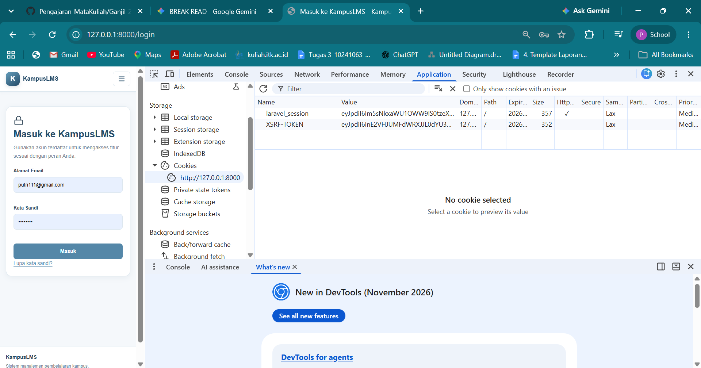
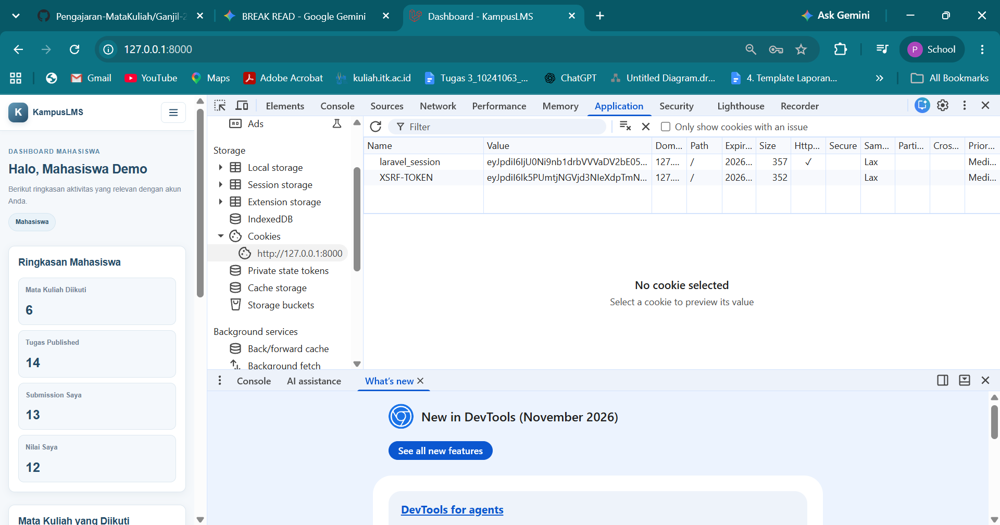

## Read 

1. Berkas mana yang menangani POST login? Method apa?

    Jawaban : 

    Berkas yang menangani POST login adalah berkas `app/Http/Controllers/Api/AuthController.php` dan Methode nya `public function login(Request $request)`

2. Di baris mana `Auth::attempt()` atau setaranya dipanggil?

    Jawaban : 

    Pemanggilan `Auth::attempt()` terletak pada baris 
    ```
    if (! Auth::attempt($credentials)) {
    throw ValidationException::withMessages([
        'email' => ['Email atau kata sandi yang Anda masukkan salah.'],
    ]);
    }
    ```

3. Temukan `session()->regenerate()`. Kenapa ia ada di situ?

    Jawaban : 

    Terletak pada berkas `app/Http/Controllers/Concerns/WebAuthContriller.php`, pada baris 

    ```
    public function store(LoginRequest $request)
    {
    $request->authenticate();
    $request->session()->regenerate(); // 
    return redirect()->route('dashboard');
    }
    ```
    dan pada baris 

    ```
    Auth::guard('web')->login($user);
    $request->session()->regenerate(); 
    ```
    Pemanggilan ini membuat Laravel menerbitkan ID sesi (session ID) baru untuk pengguna yang baru saja autentikasi. Hal ini dilakukan untuk mencegah serangan Session Fixation, di mana penyerang mencoba mencuri atau memanfaatkan ID sesi anonim/tamu yang dibuat sebelum pengguna login untuk membajak hak akses akun.

4. Di mana kata sandi di-hash? Cari cast `hashed` di model `User`.

    Jawaban : 

    Kata Sandi di hash pada saat data disimpan di database, terletak pada berkas `app/Models/User.php` Menggunakan properti `casts()` untuk otomatis menerapkan hashing pada atribut `password`

    ```
    protected function casts(): array
    {
    return [
            'email_verified_at' => 'datetime',
            'password' => 'hashed', // Cast ini memastikan password di-hash otomatis
        ];
    }
    ```

5. Buka DevTools → Cookies sebelum dan sesudah login. Bandingkan nilai cookie session.

    Jawaban : 

    Cookie sebelum login
    

    Cookie setelah login
    

   Pada pengujian DevTools browser, sebelum pengguna melakukan autentikasi pada halaman login, nilai (Value) dari cookie laravel_session tercatat diawali dengan string eyJpdGlsNWs.... Setelah pengguna berhasil melakukan login dan masuk ke halaman Dashboard, nilai dari cookie laravel_session tersebut langsung berubah total menjadi eyJpdGlsJU0N..
   Perubahan nilai cookie session tersebut terjadi akibat dieksekusinya perintah `$request->session()->regenerate()` pada berkas `WebAuthController.php` (method store). Pemanggilan fungsi ini memaksa sistem menerbitkan ID sesi (Session ID) yang baru bagi pengguna setelah statusnya berubah dari pengguna anonim/tamu menjadi pengguna terautentikasi. Mekanisme regenerasi sesi ini merupakan fitur keamanan vital untuk mencegah celah Session Fixation, yaitu serangan di mana penyerang mencoba menyisipkan atau menggunakan ID sesi anonim lama untuk mengmbil alih hak akses akun setelah pengguna asli login

6. Logout, lalu tekan tombol back. Apa yang terjadi? Kenapa?

    Jawaban : 
    Setelah menekan tombol logout dan kembali ke halaman login, penekanan tombol Back pada browser menyebabkan browser menampilkan kembali tangkapan layar (snapshot) halaman Dashboard sebelumnya. Namun, ketika dilakukan interaksi seperti mengklik menu atau memperbarui halaman (refresh), pengguna secara otomatis di-redirect kembali ke halaman login.Munculnya halaman Dashboard saat tombol Back ditekan merupakan perilaku penyimpanan memori sementara (Disk/Memory Cache) pada browser lokal. Di sisi server, sesi pengguna telah dihancurkan sepenuhnya melalui eksekusi `Auth::logout()`, `$request->session()->invalidate()`, dan `$request->session()->regenerateToken()` pada method `destroy()` di `WebAuthController.php`. Karena data sesi dan token CSRF di server sudah invalid, setiap permintaan HTTP baru ke rute terproteksi langsung ditolak.